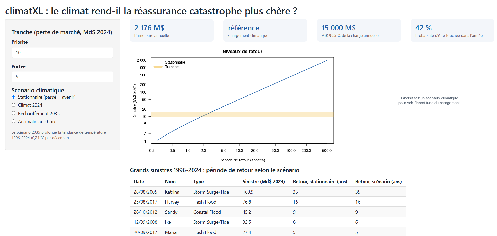

# climatXL

> Le climat rend-il la réassurance catastrophe plus chère ?

**Réponse sur 1996-2024 : pas de façon démontrable.** La prime pure de la
tranche 5 Md$ au-delà de 10 Md$ passerait de 2 176 M$ à 2 762 M$ sous un
réchauffement prolongé jusqu'en 2035 (+27 %), mais l'intervalle bootstrap de
ce chargement va d'environ −55 % à +150 %, et le modèle stationnaire passe le
backtest 2013-2024.

- 📄 Rapport : https://selyassine.github.io/climatXL/
- 📊 Application en ligne : https://climatxl.shinyapps.io/climatXL/

[](https://climatxl.shinyapps.io/climatXL/)

Ce package teste si la loi des sinistres extrêmes change avec le temps et le
climat, puis traduit la réponse en prime de traité en excédent de sinistre.
La conclusion peut aussi être « pas de tendance significative » : elle doit
seulement être démontrée.

## État d'avancement

| Semaine | Travail | État |
| --- | --- | --- |
| 1 | Package, CI, reproduction de McNeil (1997) | fait |
| 2 | Données NOAA, normalisation des pertes | fait |
| 3 | Modèle stationnaire | fait |
| 4 | Modèle non stationnaire et tests | fait |
| 5 | Tarification, scénarios, bootstrap, backtest | fait |
| 6 | Rapport Quarto, application Shiny | fait |

## Installation

```r
# install.packages("remotes")
remotes::install_github("selyassine/climatXL")
```

## Validation sur les sinistres incendie danois

```r
library(climatXL)
fit <- gpd_fit(danish$loss, threshold = 10, n_years = 11)
fit                                   # xi = 0,497 (0,136), beta = 6,97 (1,11)
gpd_risk(fit, c(0.99, 0.999))         # VaR 99 % = 27,3 ; ES 99 % = 58,2
gpd_quantile_ci(fit, 0.999)           # 94,3 [63,2 ; 189,1] par vraisemblance profilée
```

| Seuil u | Dépassements | xi (climatXL) | xi (McNeil) | x₀.₉₉₉ (climatXL) | x₀.₉₉₉ (McNeil) |
| --- | --- | --- | --- | --- | --- |
| 3 | 532 | 0,668 | 0,67 | 129 | 129 |
| 4 | 362 | 0,720 | 0,72 | 146 | 147 |
| 5 | 254 | 0,632 | 0,63 | 121 | 122 |
| 10 | 109 | 0,497 | 0,50 | 94 | 95 |
| 20 | 36 | 0,684 | 0,68 | 102 | 103 |

Ces chiffres sont vérifiés par `tests/testthat/test-mcneil1997.R`, et
l'ajustement est recoupé avec `evd::fpot` et `fExtremes::gpdFit`.
La série diffusée compte 2167 sinistres contre 2156 dans l'article, d'où
les petits écarts.

## Données NOAA (semaine 2)

```r
targets::tar_make()            # télécharge NOAA, CPI, PIB, température, ENSO
targets::tar_read(losses_norm) # un sinistre par épisode, en dollars de 2024
```

- Un sinistre = un **épisode** NOAA (un même système météo), car un traité
  catastrophe couvre un événement, pas chaque rapport local.
- Deux normalisations : `cpi` (inflation seule) et `wealth` (PIB nominal,
  donc inflation + croissance de la richesse exposée). Comparer les deux
  montre ce qui relève de l'urbanisation plutôt que du climat.
- Limites : dommages estimés et non assurés, collecte modifiée en 1996
  (passage de 3 à 48 types d'événements), normalisation nationale alors que
  les côtes se sont enrichies plus vite.

## Modèle stationnaire (semaine 3)

- **Période : 1996-2024.** Avant 1996, la NOAA ne relevait que les tornades,
  le vent et la grêle : aucun ouragan (Andrew 1992 est absent).
- **Sinistre = clause des 72 heures** sur les épisodes de plus de 50 M$ :
  Katrina passe de 6 épisodes à un seul sinistre de 164 Md$ (dollars 2024).
- **Seuil : 1 Md$** (116 dépassements, 4 par an). Au-dessus, ξ est stable
  et le QQ-plot est aligné.
- **GPD : ξ = 0,93 (0,18), β = 1,53 Md$.** La queue est extrêmement lourde :
  avec ξ proche de 1, la moyenne est à peine finie. Une tranche XL, bornée,
  garde une prime finie.

| Période de retour | Niveau de retour (Md$ 2024) | IC 95 % profilé |
| --- | --- | --- |
| 10 ans | 50 | [26 ; 144] |
| 50 ans | 229 | [75 ; 1 255] |
| 100 ans | 437 | [118 ; 3 197] |
| 200 ans | 834 | [183 ; 8 147] |

Katrina (164 Md$) a une période de retour estimée d'environ 35 ans.

## Modèle non stationnaire (semaine 4)

Sévérité : log β dépend d'une covariable, ξ constant. Fréquence : Poisson
log-linéaire du nombre annuel de sinistres > 1 Md$.

| Effet testé | Coefficient (e.t.) | Rapport de vraisemblance, p |
| --- | --- | --- |
| Sévérité ~ année (par décennie) | +0,32 (0,18) | 0,09 |
| Sévérité ~ anomalie de température (par °C) | +1,01 (0,72) | 0,16 |
| Sévérité ~ ENSO (juin-novembre) | −0,02 (0,20) | 0,91 |
| Fréquence ~ année (par décennie) | −0,21 (0,11) | 0,06 |
| Fréquence ~ température | −0,52 (0,43) | 0,22 |

**Aucun effet n'est significatif à 5 %.** Les estimations ponctuelles vont
dans des sens opposés : sinistres un peu plus graves, un peu moins
fréquents. L'année et la température sont corrélées à 0,91 : les données ne
permettent pas de séparer une tendance temporelle d'un effet climatique.

Le sinistre centennal du climat de 1996 (330 Md$) reviendrait, avec le
climat de 2024, tous les **59 ans** (estimation ponctuelle), mais
l'intervalle à 95 % va de **9 à 316 ans** et contient 100 ans : on ne peut
pas conclure à un changement.

## Tarification (semaine 5)

Tranches sur la **perte de marché américaine** (Md$ 2024), sans limite
annuelle ni reconstitution. Scénario 2035 : tendance de la température
1996-2024 (+0,24 °C par décennie), soit une anomalie de 1,32 °C.

| Scénario | Prime pure 0,5 Md$ xs 1 Md$ | Prime pure 5 Md$ xs 10 Md$ |
| --- | --- | --- |
| Stationnaire | 1 729 M$ | 2 176 M$ |
| Climat 2024 | 1 500 M$ (−13 %) | 2 505 M$ (+15 %) |
| Scénario 2035 | 1 334 M$ (−23 %) | 2 762 M$ (+27 %) |
| 2035, gravité seule | 1 847 M$ (+7 %) | 3 823 M$ (+76 %) |

- La tranche **0,5 Md$ xs 1 Md$** est touchée 98 % des années : sur une
  perte de marché, c'est une tranche « de travail », pas une tranche
  catastrophe. **5 Md$ xs 10 Md$** (touchée 42 % des années) est la
  tranche de référence.
- Le chargement climatique change de signe selon la tranche : la fréquence
  baisse (tranches basses) pendant que la gravité monte (tranches hautes).
- **Bootstrap** (années rééchantillonnées) : prime stationnaire 5 xs 10
  dans [1 186 ; 3 272] M$ ; chargement 2035 de **+27 % dans [−52 % ;
  +177 %]**. Il n'est donc pas démontré.
- **Backtest** (ajusté sur 1996-2012, testé sur 2013-2024) : le modèle
  stationnaire prévoit bien les sinistres (13,2 attendus contre 12 observés
  au-delà de 5 Md$ ; 3,1 contre 3 au-delà de 20 Md$). Le modèle climatique
  surestime les extrêmes (19,9 et 6,1 attendus).

**Conclusion : sur 1996-2024, les données NOAA ne justifient pas de
chargement climatique démontrable.** L'incertitude d'estimation (±50 % à
±180 %) dépasse largement l'effet climatique estimé.

## Structure

```
R/                 fonctions : lecture NOAA, normalisation, GPD, tarification
tests/testthat/    tests (dont la reproduction de McNeil 1997)
_targets.R         pipeline : données brutes -> résultats -> paramètres de l'app
analyse/           scripts exploratoires des semaines 3 à 5
rapport/           note actuarielle Quarto (site web)
app/               application Shiny
.github/workflows/ R CMD check automatique
```

## Mise en ligne

```r
targets::tar_make()                       # refait toute l'analyse
```
```sh
quarto render rapport                     # construit le site du rapport
quarto publish gh-pages rapport           # le publie sur GitHub Pages
```
```r
# Application : une fois le compte shinyapps.io relié avec rsconnect::setAccountInfo()
rsconnect::deployApp("app", appName = "climatXL")
```

## Pipeline

```r
targets::tar_make()
```

## Référence

McNeil, A. J. (1997). Estimating the tails of loss severity distributions
using extreme value theory. *ASTIN Bulletin*, 27(1), 117-137.
